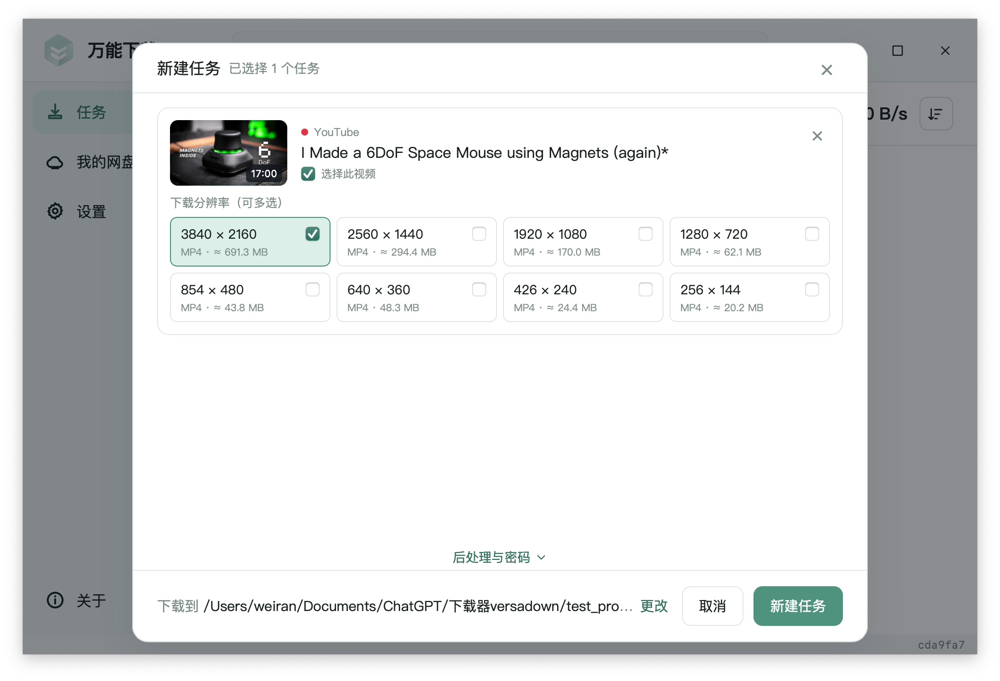
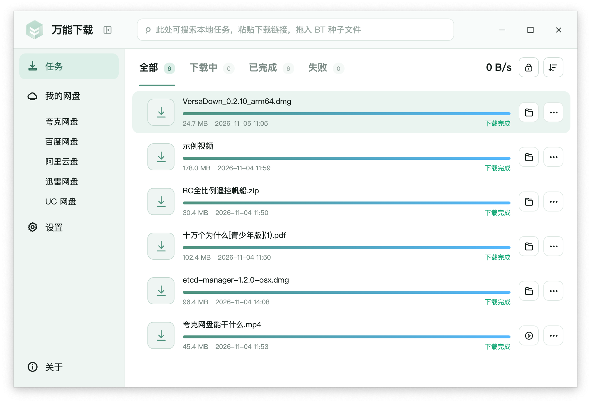
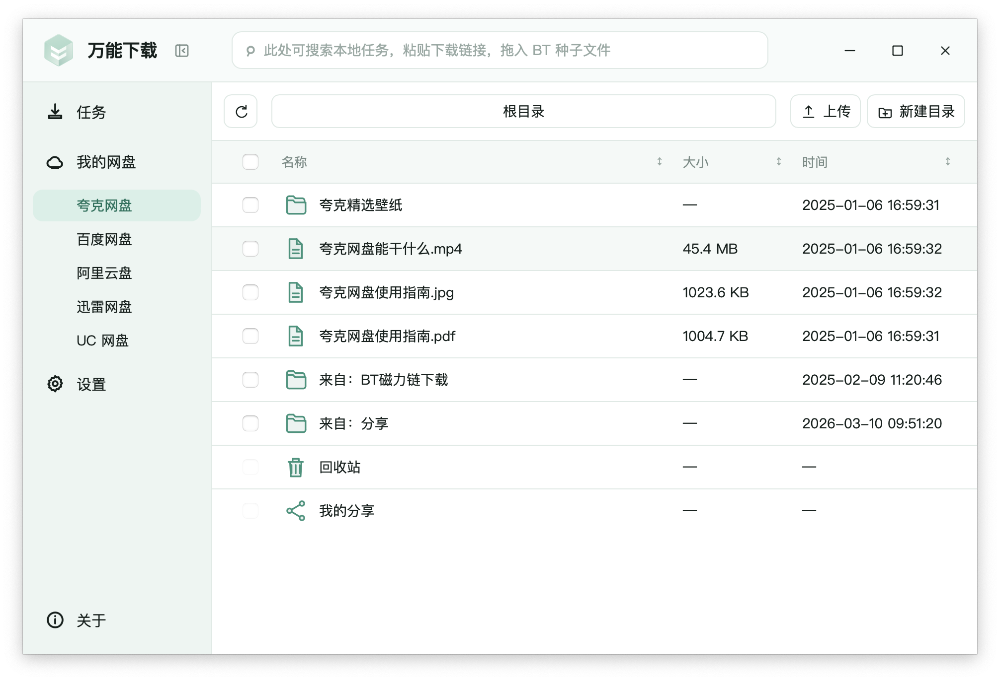
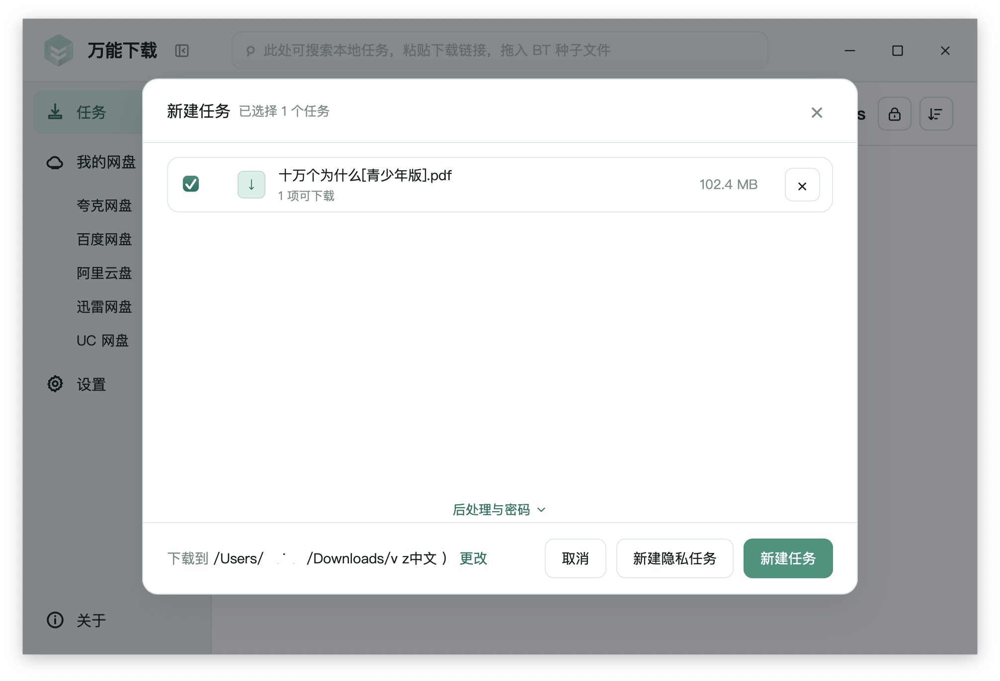
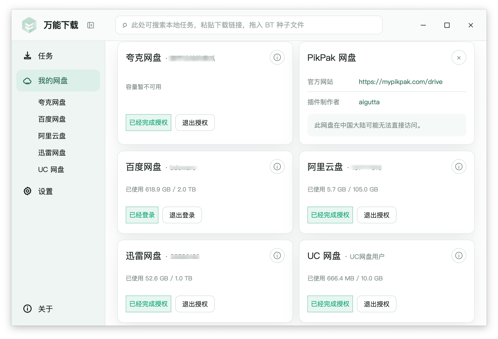
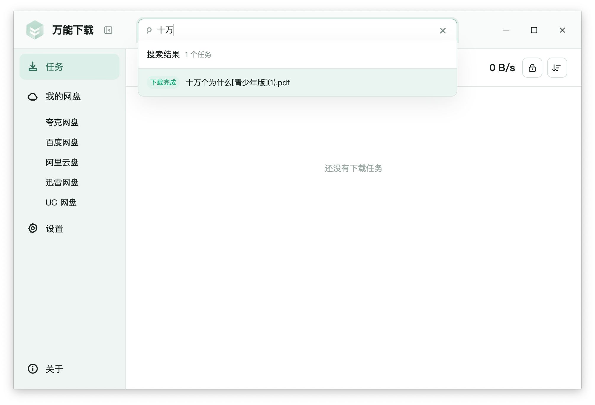
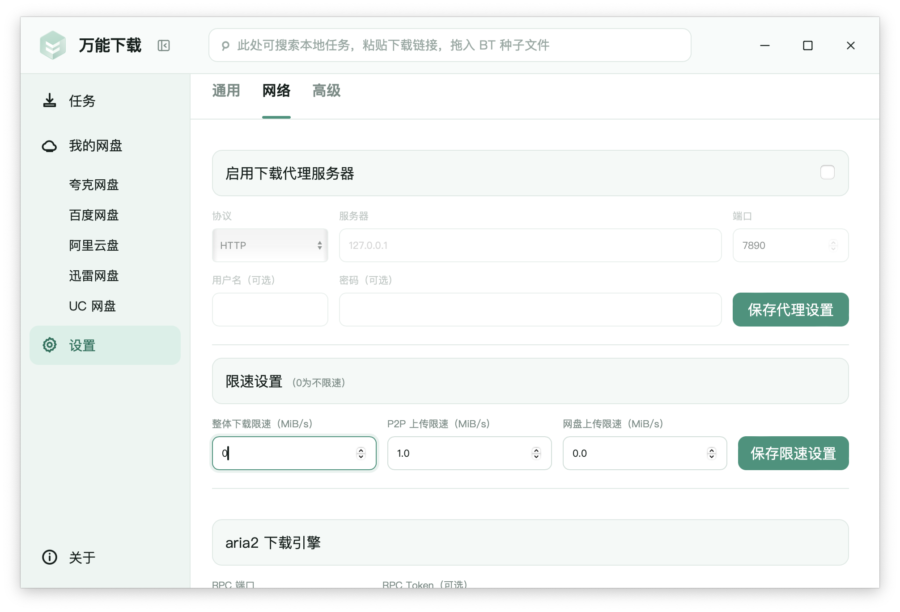
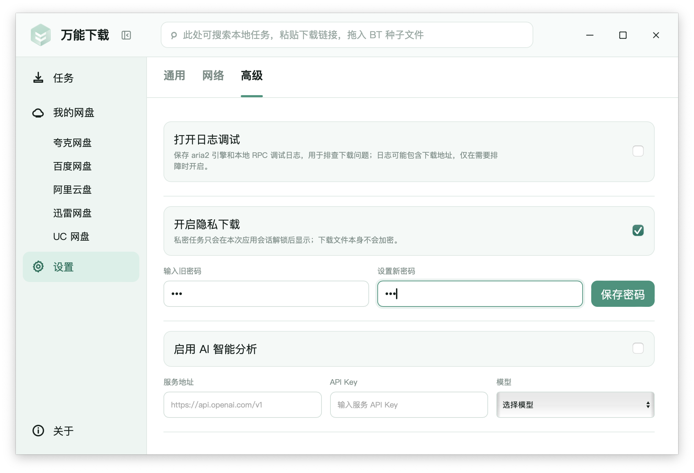

# VersaDown（VD）

**把文件下载、网页视频和网盘文件，放进同一个下载管理器。**

VersaDown 是一款本地优先的桌面下载客户端，支持 Windows、macOS 和 Linux。粘贴直链、磁力链接、种子、视频播放页或网盘分享链接，即可识别内容、选择文件并管理下载；也可以从悬浮输入窗快速创建任务。

[下载安装](https://github.com/liuwenhuan/versadown/releases/latest) · [更新日志](https://github.com/liuwenhuan/versadown/releases) · [问题反馈](https://github.com/liuwenhuan/versadown/issues) · [开发与构建](docs/development.md)

[功能特性](#功能特性) · [视频解析与下载](#视频解析与下载) · [自动更新检测](#自动更新检测) · [功能截图](#功能截图)

## 下载与安装

在 [GitHub Releases](https://github.com/liuwenhuan/versadown/releases/latest) 中选择适合系统和处理器架构的安装包。

| 平台 | 安装包 | 使用说明 |
| --- | --- | --- |
| Windows 10 / 11 · x64 | `.exe` 安装程序 | 运行安装程序，需要 WebView2 Runtime |
| macOS 12+ · Apple Silicon / Intel | 对应架构的 `.dmg` | 将 `VersaDown.app` 拖入 Applications |
| Linux · x86_64 | `.deb`、`.rpm`、`.AppImage` | 按发行版选择安装包，或运行 AppImage |

首次打开后，可在「设置」中选择下载目录、语言和主题。安装包已包含下载引擎及视频解析、合并组件，无需另装 yt-dlp 或 FFmpeg；源码运行方式见[开发文档](docs/development.md)。

## 功能特性

| 功能 | 可以做什么 |
| --- | --- |
| 多协议下载 | 下载 HTTP/HTTPS、FTP、ED2K 文件，以及 HLS（`.m3u8`）、MPEG-DASH（`.mpd`）媒体；识别磁力、`.torrent` 和迅雷链接，支持选择 BT 任务中的文件 |
| 批量创建任务 | 一次粘贴多条链接或包含链接的文本，逐项查看识别结果、勾选文件并确认下载；遇到重复任务时选择继续下载、打开已有文件位置或重新下载 |
| 下载队列与续传 | 查看进度、速度和任务状态，暂停、继续、取消、重试及批量操作；支持断点续传、重启后恢复任务列表，以及目录任务分组、搜索和排序 |
| 网页视频解析 | 解析播放页，预览封面、标题和时长，选择一个或多个分辨率下载；分离提供的画面和声音自动合并 |
| 多网盘管理 | 接入夸克、PikPak、百度网盘、阿里云盘、迅雷网盘和 UC 网盘；授权后浏览、上传和下载文件，管理目录、回收站与分享链接 |
| 分享链接下载 | 识别网盘分享链接与提取码，查看分享文件、选择下载内容，并按服务商要求完成授权或转存；MEGA 公开文件/文件夹链接（含 `#密钥`）无需登录，下载时在本机流式解密；Gofile 分享页（`gofile.io/d/…`）在内置浏览器窗口中打开，由你在页面里输入密码、点击文件，软件接管该次下载 |
| 并发、代理与限速 | 调整最大并发任务数、单任务连接数和 BT 分享率；配置下载代理、整体下载限速，以及 P2P 和网盘上传限速 |
| 隐私任务 | 使用密码锁定和解锁隐私任务，在本次应用会话中控制其显示；下载文件本身不加密 |
| 桌面使用体验 | 悬浮快捷入口、下载状态通知、多种明暗主题和中英文等多语言界面；可关联磁力、迅雷和电驴链接 |

断点续传取决于来源服务、链接有效性和本地断点是否完整。网盘操作及下载速度受账号权限、会员权益、服务商接口和网络条件影响，具体可用操作以应用界面为准。

## 视频解析与下载

直接粘贴视频播放页，就能查看可下载的清晰度，无需先寻找媒体直链。

1. **粘贴播放页**：在主输入框粘贴一个或多个视频链接，多条链接可分行输入。YouTube、哔哩哔哩支持短链，哔哩哔哩支持分 P 播放页。
2. **选择视频和清晰度**：在「新建下载」中查看封面、标题、时长、分辨率、格式和可用的大小估计；可以同时勾选多个视频，也可为同一视频选择多个分辨率。
3. **加入下载队列**：选择保存位置并创建任务。画面和声音分开提供时，VD 会自动下载并合并；视频任务也可以暂停、继续和重试。

央视、AcFun、微博、PeerTube、Wikimedia 等点播站点通过本机 yt-dlp 使用同一解析流程。普通网页或未识别的分享短链也会先尝试查找视频；没有找到时，可以选择「改为普通下载」。

需要登录的视频，可在「设置 → 网络 → 视频下载 Cookie」中选择自己有权使用的 Netscape `cookies.txt` 文件，之后的解析、新下载和重试会使用该配置。VD 不会自动读取浏览器 Cookie。

可选分辨率取决于网站向当前用户提供的格式。当前面向单个点播视频，不支持直播录制、整套播放列表下载或 DRM 内容；站点支持情况也会受视频状态、访问权限、地区和网络影响。视频组件随 VD 版本更新，详情见[视频工具与许可证](src-tauri/video-tool-notices/SOURCE.md)。

## 自动更新检测

VD 启动后会在后台检查官网发布的版本信息，也可在「关于」页点击「检查更新」手动检查。

- **发现新版**：侧栏「关于」入口显示「有更新」提示。
- **查看变化**：在关于页查看新版本号与更新摘要。
- **前往更新**：点击「去官网下载」，选择适合当前系统的安装包。

当前更新流程为自动检测、提醒，再由用户下载安装。检查失败不会阻止正常下载，也可直接访问 [Releases](https://github.com/liuwenhuan/versadown/releases/latest) 获取安装包。

## 功能截图

以下截图来自 macOS 实际运行界面；不同版本、平台和主题的外观可能略有差异。视频解析截图见[上方章节](#视频解析与下载)。

### 下载管理

统一查看下载进度和速度，按状态筛选任务，并进行暂停、继续等操作。

### 网盘文件管理

在同一个窗口中切换已授权网盘，浏览文件，并使用上传、新建目录、回收站和「我的分享」入口。

更多操作：新建下载、网盘授权与任务搜索

### 新建下载

查看已识别的文件信息，选择保存位置后创建任务。

### 网盘授权

集中管理六个网盘服务的授权状态。

### 任务搜索

按关键词查找已有任务。

更多设置：代理、限速与隐私任务

### 网络设置

配置代理与下载、上传限速。

### 隐私设置

启用隐私下载并设置解锁密码。

## 本地数据与隐私

任务记录和设置保存在本机，网盘授权凭据通过系统凭据存储保护。隐私模式控制任务在界面中的可见性，不会加密磁盘上的下载文件。调试日志默认关闭，需要排障时再开启；日志可能包含下载地址。

可选的 AI 智能分析用于辅助理解复杂文本，启用后会将当前任务的脱敏可读文本发送到用户配置的服务。下载内容应在本人权限范围内使用；VD 不共享账号或下载凭据，也不绕过站点验证、会员限制和 DRM。

## 开发与贡献

VD 使用 Tauri 2、React、TypeScript 和 Rust，桌面界面使用系统 WebView。文件与媒体下载由 aria2-next、Rust FTP 引擎及 yt-dlp / FFmpeg 等组件协作完成。

- [开发与构建](docs/development.md)：环境准备、各平台 quick / Release 构建、产物位置和验证命令。
- [开发与验证约定](AGENTS.md)：修改代码前的协作规则。
- [第三方组件说明](THIRD_PARTY_NOTICES.md)：依赖、协议参考、许可证与对应源码。
- [提交问题或建议](https://github.com/liuwenhuan/versadown/issues)：请附应用版本、操作系统和复现步骤，分享日志前移除账号凭据及私密链接。
